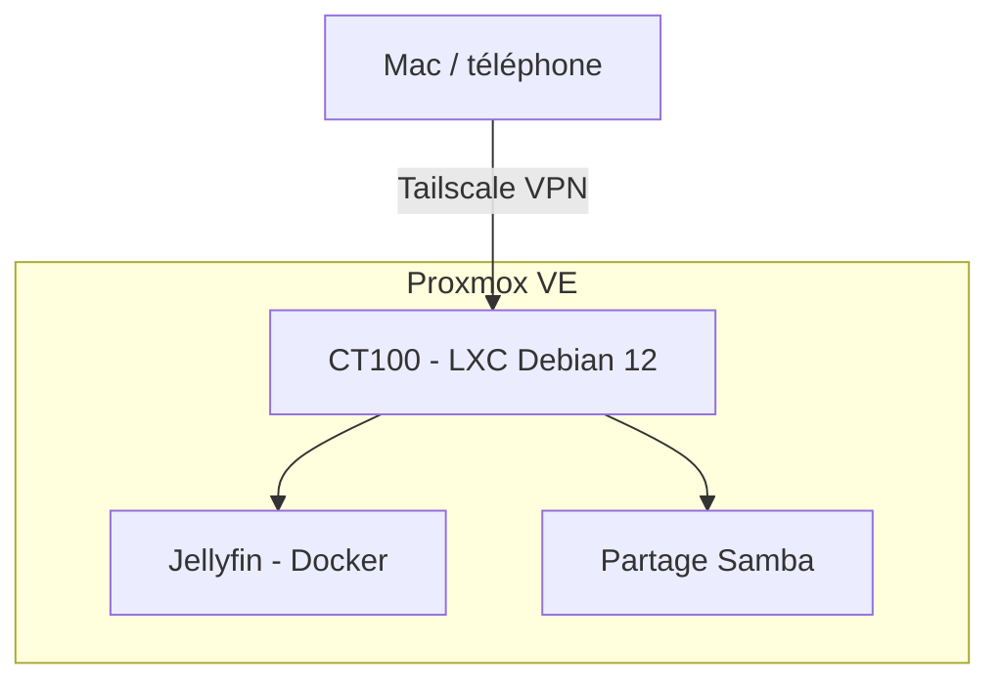

# Homelab

Serveur auto-hébergé pour apprendre l'administration système et la cybersécurité.

## Matériel
- Lenovo Legion Y520 (Intel Core i5-7300HQ, 16 Go de RAM)
- SSD 500 Go

## Architecture

## Services

| Service | Type | Rôle |
|---|---|---|
| Jellyfin | Docker dans LXC | Serveur multimédia |
| Samba | LXC | Partage de fichiers |
| Tailscale | LXC | Accès distant par VPN, sans port ouvert |

## Feuille de route
- [x] Installation de Proxmox VE
- [x] Jellyfin dans un conteneur LXC non privilégié
- [x] Accès distant via Tailscale
- [ ] Durcissement SSH (clés uniquement, fail2ban)
- [ ] Double authentification sur Proxmox
- [ ] Serveur Minecraft
- [ ] Labo de pentest isolé (Kali, Metasploitable)
- [ ] Supervision avec Wazuh
